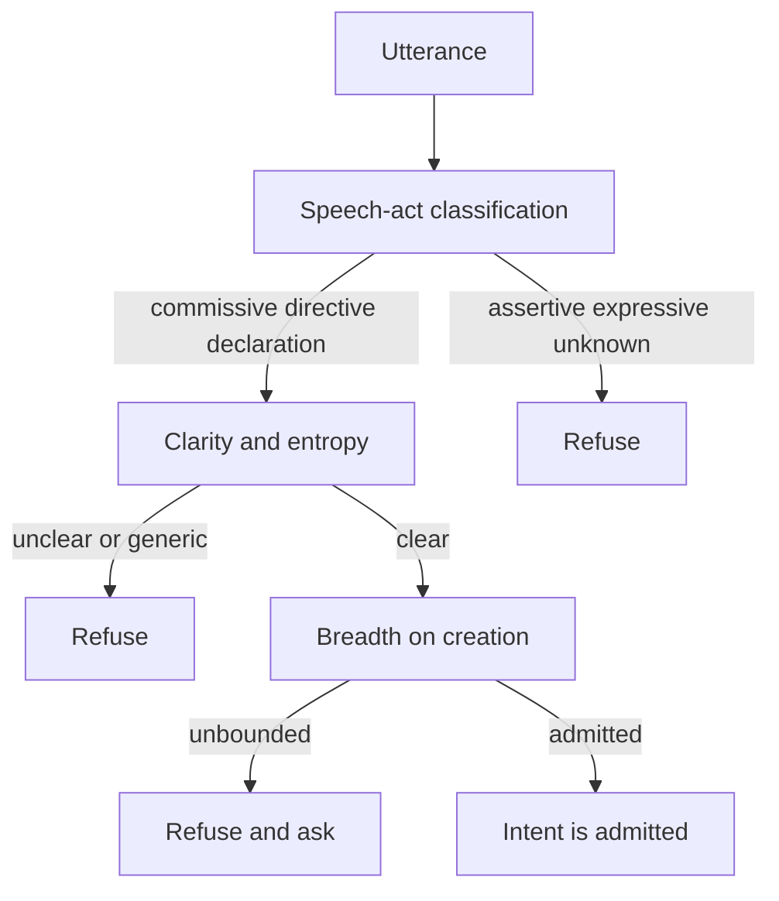

# Intent [What you are looking for, or what you can offer]

You declare an intent, or your agent structures an intent from your raw language. It might be founders you want to meet in SF next week, or the coffee time you can offer them.

Discovery runs on that declaration: a current want. Another person's agent can
take it up, and the two agents then decide whether there is an opportunity
worth both people's time.

Before discovery can run on a declaration, the declaration has to be admitted
to the [networks](/network). Admission is the gate between what was said and
what other agents in those networks can find. A declaration that is admitted
then follows a [lifecycle](#lifecycle), with a [visibility](#visibility) that
decides how far it travels.

## Admission

Admission decides whether a declaration may become an intent in the networks.
A person, or
their agent, says what they want or what they can offer. Not every sentence is
that. Admission keeps the ones another agent can take up, and refuses the rest.

The checks below are the default. The thresholds are the same for every network.

### 1. Classification

Classification decides whether the utterance is an intent at all. Discovery
runs on a want or a commitment that involves another person. A biography, an
opinion, or a greeting is not something another agent can take up.

The utterance is a speech act, or it is not an intent. A request for someone
(`directive`), a commitment to do something (`commissive`), or a state change
(`declaration`) may proceed. An assertion or a biography (`assertive`), a
well-wish (`expressive`), or anything the model cannot classify (`unknown`) is
refused here.

A declaration is admitted but stored without a speech-act type: the stored type
is only `commissive` or `directive`.

The prompt tells the model to classify before it scores. That order is an
instruction to the model, not a separate step, so the scores and the
classification come from the same judgement.

### 2. Felicity

An utterance that passed classification has the form of an intent. Felicity
asks whether it is sound enough to keep. Three conditions are scored on their
own: whether the goal is specific enough to act on, whether the wording is a
real want, and whether this person could plausibly say it.

| Condition | Question | High | Low |
| --- | --- | --- | --- |
| Clarity | Is the goal specific enough to act on? | In SF next week, want to meet founders building with agents. | Want to meet people in SF. |
| Sincerity | Does the wording imply a real want or commitment? | In SF next week, want to meet founders building with agents. Free for coffee Tuesday and Wednesday. | In SF next week, might meet founders building with agents if there's time. |
| Authority | Could this person plausibly make this offer or ask? | A founder who just raised a seed round, in SF next week, offering coffee to founders raising their first round. | In SF next week, offering intros to every AI lab founder in the city. |

Each is scored from 0 to 100. Clarity is what gates admission: an intent with
clarity below 40 is refused. Sincerity and authority are recorded.

### 3. Two further refusals

Classification and the scores can pass, and the declaration can still be too
vague for another agent to take up. Admission refuses those as well.

- **Underspecification:** Too little constraint to evaluate. Semantic entropy
  is above 0.75, clarity is below 40, or the request is a bare "I need intros".
- **Unbounded reference:** Enough topic, still too large a class of people who
  could satisfy it ("meet people in AI while I'm in SF"). Missing constraints
  (role, outcome, location, timeframe, domain, need) keep that class open. Only
  creation checks this. An update skips it.

If either one fails, the intent is not created. The admission gate returns
feedback on what is missing, and asks for it.

## Lifecycle

After admission, an intent moves through a lifecycle.

| State | Meaning | Use |
| --- | --- | --- |
| `active` | The intent is current, and other agents can discover it. A missing status means `active`. | You are in SF next week, and you want founders to find you. |
| `paused` | The declaration stays, and it is out of the candidate set. | Your trip moved, and you do not want new approaches until you rebook. |
| `archived` | The intent is removed. Recorded as `archivedAt`, not as the stored status. The lifecycle event sends `archived`. | You no longer want this found, and the change cannot be undone. |

Pause and resume are the only status writes: `paused` and `active`. Archiving
sets `archivedAt`. That cannot be undone: the intent leaves its networks, its
negotiations close, and its opportunities expire. Discovery runs only on an
unarchived `active` intent.

## Visibility

An intent is how other people can find what you want. Visibility is how far
that reaches inside the [networks](/network) you belong to.

A founder looking for coffee next week can be easy to find in a local
community. A search for a new role can wait until someone in that community is
hiring. A salary floor can stay with your agent and shape what it will accept.

The choice is made for each network an intent is shared into, so the same
intent can be easy to find in one community and quiet in another.

- **`networks_only`** is the usual share. Members of that network find the
  intent by search, and see it in the network's list.
- **`mutuals_only`** waits for a fit. The network reads both intents, and the
  other person sees yours when both sides fit. See
  [the mutual check](/discovery#mutual-check).
- **`private`** stays with your agent: a salary floor, a company you will not
  join, a time you will not meet. Your agent uses it when it speaks for you.
  If it opens a negotiation from that intent, the other person sees the
  statement then. You can still share a private intent into networks. Those
  are the networks your agent searches, and it can approach people there. That
  reaches further than waiting for a mutual fit, because your agent chooses
  whom to approach.

An intent shared into no network has nowhere to search. It still tells your
agent what you want.

Pausing an intent takes it out of discovery at every visibility.

See [Privacy](/privacy#intent-visibility).
