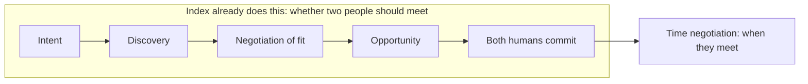

# Privacy-preserving agent-to-agent time negotiation

This is a work-in-progress design discussion, not a decision. It proposes a privacy-preserving way for agents to negotiate a meeting time after an Index opportunity has been accepted. The proposed direction is marked as such, with tradeoffs left open for discussion.

This document follows the same five-part structure as the supporting [FigJam board](https://www.figma.com/board/L6q83cu7qJjJSnON0hST5t): context, core workflows, data model, systems diagram, and API.

## 1. Context

Index already covers intents, discovery, agent-to-agent negotiation of fit, and a double opt-in opportunity. When both humans accept, the protocol has answered *whether* these two people should talk. What happens next, today, is logistics in a chat — usually a booking link.

That is a seam, not a failure. The current negotiator is explicit that fit negotiation is not supposed to arrange anything. From `packages/agent/src/negotiate.ts`:

> Nothing is being arranged: scheduling beyond rough availability, locations more precise than a required city or district, prices, addresses and project specifics are for the two of them once they are talking.

The protocol prompt is consistent with that. From `packages/protocol/src/protocol/protocol.prompt.ts`:

> An intent describes a goal, not qualifications, resources, availability, or authority.

The gap is therefore narrow and well-bounded: after both people have committed to an opportunity, how do they reach an agreed time without turning Index into a calendar product, without dumping calendars into the intent graph, and without forcing everyone onto one booking tool?

The [Primitive Map](https://indexnetwork.github.io/primitives/) (source: [indexnetwork/primitives](https://github.com/indexnetwork/primitives)) is a useful vocabulary here. It treats calendars, like CRMs and messaging apps, as products shaped by historical software boundaries, not as fundamental coordination primitives. There is no Availability primitive on the map, and this proposal does not invent one. Time negotiation composes existing primitives:

- An **Opportunity** is already there: matched mutual intents, with **Consent** when both humans commit.
- **Workflow 1** (connect availability) uses **Delegation** and **Consent**. The calendar itself is a source of facts, not a primitive.
- **Workflow 2** (optional preferences) uses **Preference**, plus limits on Delegation.
- **Workflow 3** (confirm a time) produces an **Agreement** and each side's **Commitment**.
- **Workflow 4** and **Workflow 5** are **Negotiation** of time, under Delegation. Workflow 4 keeps Index furthest from the calendar.

Index should remain the intent graph and the opportunity graph. Scheduling is a later Negotiation that leads to an Agreement, not a reason to start storing calendars.

## 2. Core workflows

Five workflows, in order. Workflows 3, 4, and 5 end at "Confirm a time" unless the path is fully automatic.

### Workflow 1 — Connect availability

A new connection on the user's **profile**, separate from intents. An intent describes a goal, not availability.

Two kinds of connection:

- A **readable calendar** (Google Calendar, ICS / CalDAV), which can be read to propose times.
- A **booking link** that can only be booked against (Calendly, Cal.com).

The primitives here are Delegation (limited authority to read the person's time) and Consent (what level of detail is shared). Calendars are the source of facts, not primitives. Other third-party providers should fit the same connection model through the adapter layer in section 4.

### Workflow 2 — Availability preferences (optional)

Standing rules that can exist with or without a connection: hours, days, meeting length, buffers, in-person vs remote, and how much autonomy the negotiator has. The primitives are Preference, plus limits on Delegation.

### Workflow 3 — Time Confirmation

UI label: "Confirm a time." On the accepted opportunity, Index shows a short list of times. Each person can pick one, suggest others, or decline. When both confirm, that produces an Agreement plus each side's Commitment. Workflow 4 and Workflow 5 end here unless the path is fully automatic.

A full calendar should not be sent to Index or to the other party. A reasonable starting point is that each side shares only a small candidate set of slots; only the intersection is shown. The human still confirms before any provider writes an event.

### Workflow 4 — Personal agent negotiates

The owner's agent (Grok Bot, Hermes, Dot, and others) takes turns over MCP and checks the calendar its own way. Index only relays the turns and records the outcome. This is Negotiation under Delegation. Index sees the least.

Not everyone has a personal agent, and those agents do not share a runtime. Confirmation can still be shown in Index so the UX stays recognizable.

### Workflow 5 — Index negotiates

Index's negotiator uses Workflow 1 and Workflow 2, and reuses the existing propose / counter / accept / decline pattern on `negotiation_turns`. This is the default when there is no personal agent.

This is where the **in-model vs separate-layer** choice matters most:

- **In-model:** add a scheduling phase on the existing negotiation. Reuse `negotiation_turns` with a structured slot payload.
- **Separate layer:** the accepted opportunity hands off to a scheduling session. Fit tables stay fit-only. The scheduling layer holds `scheduling_sessions` and `slot_proposals`. Index stores a session pointer plus the confirmed Agreement.

**Proposed direction:** architect the separate layer, and reuse the turn pattern there. Prefer Workflow 4 when both people have a personal agent. Use Workflow 5 (a thin negotiator plus provider adapters) when someone does not. Do not put availability windows onto `intents`. The tradeoffs are in section 3 and remain open for discussion.

A separate layer is looser coupling, a better fit for not becoming a calendar product, and easier to federate: a self-hosted Index can invoke local providers, and Index need not see raw calendars. The cost is a new session and a handoff contract, and the UX has to be designed across Index and providers. Extending the existing model reuses the turn log, the hosted negotiator, and the opportunity inbox, but calendar-like data would sit next to intents in the same Postgres, which is harder to federate and a weaker privacy boundary.

### Notifications

Paths used across the workflows:

- To the human — email today, then in-app or push (Workflows 1–5, especially Workflow 3).
- Index to the agent — a webhook or callback URL, or the agent polling over MCP (Workflow 4).
- Agent-to-agent turns (Workflow 4).
- Human to agent (Workflows 3 and 4).
- Timeouts and reminders when one side goes quiet (Workflows 3, 4, and 5).

### Exceptions and scope

In scope as cross-cutting exceptions: reschedule or cancel after confirmation, and the case where one side is unresponsive.

Out of scope for a first version: **group scheduling**. A separate scheduling layer is meant to leave room for it later, without stretching the bilateral fit-negotiation log.

## 3. Data model

Current tables and fields are from `services/api/src/schemas/database.schema.ts` and `services/api/src/schemas/conversation.schema.ts`. There are no calendar or availability tables today, which is consistent with the comments in `negotiate.ts` and `protocol.prompt.ts`.

`opportunities` has no foreign key to intents. The matched intents live on `negotiations.initiator_intent_id` and `negotiations.responder_intent_id`. `conversation_participants.participant_id` and `messages.sender_id` are not formal foreign keys in the schema. Some user-auth and intent-embedding columns are omitted here.

### Existing tables (relevant subset)

- `users` — `id` (PK); `email`, `name`, `timezone`, `intro`, `location`, `created_at`
- `intents` — `id` (PK); `user_id` (FK → `users.id`); `payload`, `summary`, `status`, `source_type`, `is_private`, `archived_at`
- `opportunities` — `id` (PK); `status`, `confidence`, `actors`, `detection`, `interpretation`, `context`, `metadata`, `expires_at`, `created_at`, `updated_at`
- `opportunity_events` — `id` (PK); `opportunity_id` (FK → `opportunities.id`); `type`; `actor_user_id` (FK → `users.id`); `at`, `data`
- `negotiations` — `id` (PK); `pair_key`; `opportunity_id` (FK → `opportunities.id`); `initiator_user_id`, `responder_user_id`, `awaiting_user_id` (FK → `users.id`); `initiator_intent_id`, `responder_intent_id` (FK → `intents.id`); `outcome`, `settled_at`, `created_at`, `updated_at`
- `negotiation_turns` — `id` (PK); `negotiation_id` (FK → `negotiations.id`); `turn_index`; `seat_user_id` (FK → `users.id`); `action`, `message`, `client_turn_id`, `created_at`
- `agents` — `id` (PK); `owner_id` (FK → `users.id`); `name`, `type`, `status`, `runtime_kind`, `handle_negotiations`, `notify_on_opportunity`
- `agent_sessions` — composite PK `user_id` + `intent_id` (both also FKs → `users.id` and `intents.id`); `conversation_id` (FK → `conversations.id`); `state`, `revision`, `lease_token`, `lease_expires_at`
- `conversations` — `id` (PK); `dm_pair`, `last_message_at`, `created_at`, `updated_at`
- `conversation_participants` — composite PK `conversation_id` + `participant_id`; `conversation_id` (FK → `conversations.id`); `participant_type`, `joined_at`, `hidden_at`, `last_read_at`
- `conversation_sessions` — `id` (PK); `conversation_id` (FK → `conversations.id`); `started_at`, `last_message_at`, `created_at`
- `messages` — `id` (PK); `conversation_id` (FK → `conversations.id`); `session_id` (FK → `conversation_sessions.id`); `sender_id`, `role`, `parts`, `metadata`, `extensions`, `created_at`
- `conversation_metadata` — `conversation_id` is PK and FK → `conversations.id`; `metadata`, `created_at`, `updated_at`

### Proposed tables (not in the repo)

These are proposed, not implemented.

- `availability_connections` — profile-level connection for Workflow 1. `id` (PK); `user_id` (FK → `users.id`); `kind` (`readable_calendar` | `booking_link`); `provider` (`google` | `ics` | `caldav` | `calendly` | `cal.com`, and other third-party providers through the same adapter); `status`, `consent_scope`, `created_at`, `updated_at`
- `availability_preferences` — standing rules for Workflow 2. `id` (PK); `user_id` (FK → `users.id`); `hours`, `days`, `meeting_length`, `buffer`, `location_mode`, `autonomy`, `created_at`, `updated_at`
- `time_confirmations` — Workflow 3 "Confirm a time." `id` (PK); `opportunity_id` (FK → `opportunities.id`); `slots`; `status` (`pending` | `confirmed` | `declined` | `expired`); `confirmed_start`, `confirmed_end`, `timezone`, `confirmed_by`, `created_at`, `updated_at`

### Workflow 5 storage options

- **In-model:** reuse `negotiation_turns` (`propose`, `counter`, `accept`, `decline`) with a structured slot payload.
- **Separate layer (proposed direction):** `scheduling_sessions` and `slot_proposals`; fit tables stay fit-only. Index stores a session pointer plus the confirmed Agreement.

## 4. Systems diagram

The systems view on the FigJam board places a scheduling layer next to Index's existing API host, agent runtimes, and data stores. Provider adapters sit at the edge. They are how Workflow 1 and Workflow 5 talk to calendars and booking tools, without those products becoming Index primitives.

Adapters to support first:

- Calendly
- ICS / CalDAV
- Cal.com
- Google Calendar
- Other third-party providers, through the same adapter interface

The scheduling layer is shown in two variants, matching section 2: a scheduling phase on the existing model, or a separate scheduling layer with a handoff. Session pointer and Agreement write back to Index in the separate-layer case. Clients (web app, personal agents over MCP), notifications (email today), and hosted or external agents (including `@indexnetwork/agent`) stay in their current roles.

A conceptual adapter interface, not built:

- `listCandidateSlots({ window, duration, constraints })`
- `proposeSlot` / `respondToSlot`
- `commitSlot` — only after both humans confirm
- `cancelSlot`

Index should not pick a winner among providers or ship its own calendar product.

## 5. API

REST controllers live under `services/api/src/controllers/`, with prefix `/api` (`GLOBAL_PREFIX` in `services/api/src/main.ts`). MCP tools live in `services/api/src/lib/mcp/mcp.tools.ts`.

### Current REST

From `opportunity.controller.ts` (`/api/opportunities`): `GET /`, `POST /`, `POST /pair`, `POST /:id/link-action`, `GET /:id`, `PATCH /:id/status`, `POST /:id/start-chat`, `POST /:id/events`, `GET /:id/negotiation`, `POST /:id/negotiation/resume`, `POST /:id/negotiation/turns`.

From `negotiation.controller.ts`: `GET /api/negotiations`.

From `intent.controller.ts`: `POST` and `GET /api/intents/:id/opportunities`, `PATCH /api/intents/:id/opportunities/:opportunityId/status`, `POST /api/intents/:id/opportunities/:opportunityId/start-chat`.

From `conversation.controller.ts`: conversation and message routes, including DMs. From `events.controller.ts`: `GET /api/events/log`, `GET /api/events`.

### Current MCP

`get_my_profile`, `update_my_profile`, `enrich_my_profile`, `list_intents`, `get_intent`, `create_intent`, `update_intent`, `pause_intent`, `resume_intent`, `archive_intent`, `join_network`, `list_opportunities`, `get_opportunity`, `list_negotiations`, `get_negotiation`, `get_intent_conversation`, `principal_send_message`, plus `accept_opportunity` and `reject_opportunity`.

Relevant to opportunities, negotiation, and chat after a match. Profile and intent tools are also registered in the same file.

### Proposed (not in the repo today)

Grouped by workflow, as on the board.

**Setup (Workflow 1–2)**

- REST: `GET`/`POST /api/users/me/availability-connections`, `DELETE /api/users/me/availability-connections/:id`, `GET`/`PATCH /api/users/me/availability-preferences`
- MCP: `list_connections`, `connect_calendar`, `disconnect_connection`, `get_availability_preferences`, `update_availability_preferences`

**Confirm a time (Workflow 3)**

- REST: `GET /api/opportunities/:id/times`, `POST /api/opportunities/:id/confirm`, `POST /api/opportunities/:id/suggest`, `POST /api/opportunities/:id/decline`
- MCP: `list_proposed_times`, `confirm_time`, `suggest_times`, `decline_times`

**Negotiation (Workflow 4–5)**

- Workflow 4 MCP: `propose_times`, `respond`, `confirm`. REST: `POST /api/agents/me/callback` (webhook URL).
- Workflow 5 reuses `POST /api/opportunities/:id/negotiation/turns`. In-model: slot payload on those turns. Separate layer: `POST /api/opportunities/:id/schedule`, plus `/propose`, `/respond`, `/confirm`.

## Open questions

Still open, and not a complete implementation plan:

1. **UX surface.** Should "Confirm a time" live in the Index inbox, the personal agent, or both? Keeping confirmation in Index even when agents do the proposing would help the UX stay recognizable.
2. **In-model vs separate layer.** The key decision, especially for Workflow 5. The proposed direction is a separate layer that reuses the turn pattern.
3. **How much slot state Index keeps.** A reasonable default, under the proposed direction, is the session pointer and the confirmed Agreement.
4. **Notifications.** Index already notifies by email. In-app or push, and the channel after an Agreement, are still open.
5. **Trust, spam, and federation.** How scheduling inherits Index's trust mechanism, and how this works for a self-hosted network, is still open. A separate layer is meant to federate more cleanly.
