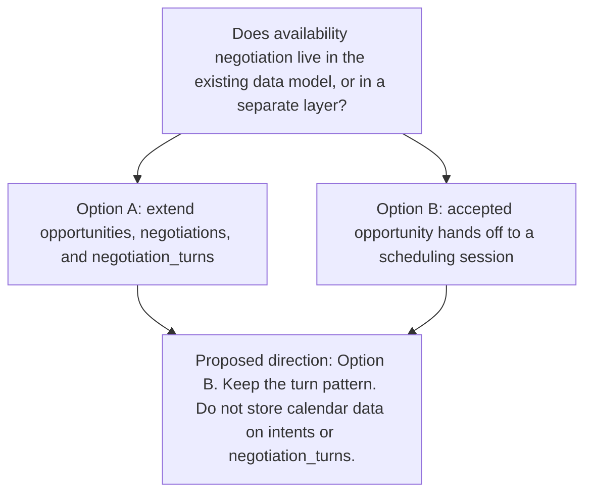
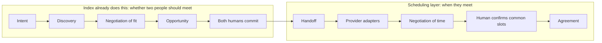
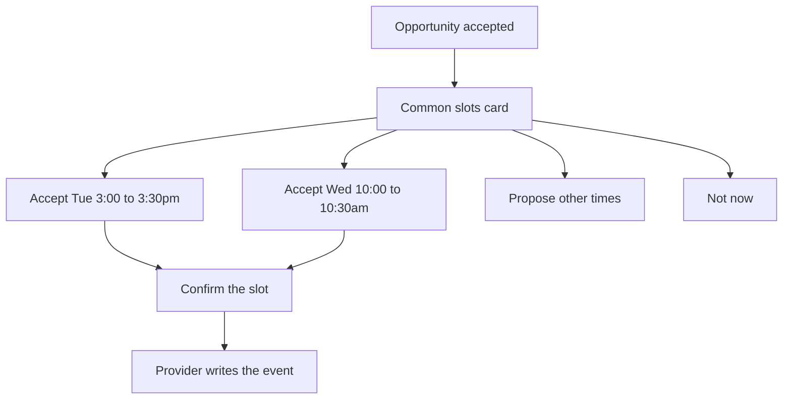

# Privacy-preserving agent-to-agent time negotiation

This document proposes a privacy-preserving way for agents to negotiate a meeting time after an Index opportunity has been accepted. It is a design discussion, not a decision. The proposed direction is marked as such, with tradeoffs left open for discussion.

Supporting diagrams: [FigJam board](https://www.figma.com/board/P1bSbFjfO7b0EYIHfbllO5).

## The problem

Index already covers intents, discovery, agent-to-agent negotiation of fit, and a double opt-in opportunity. When both humans accept, the protocol has answered *whether* these two people should talk. What happens next, today, is logistics in a chat — usually a booking link.

That is a seam, not a failure. The current negotiator is explicit that fit negotiation is not supposed to arrange anything. From `packages/agent/src/negotiate.ts`:

> Nothing is being arranged: scheduling beyond rough availability, locations more precise than a required city or district, prices, addresses and project specifics are for the two of them once they are talking.

The protocol prompt is consistent with that. From `packages/protocol/src/protocol/protocol.prompt.ts`:

> An intent describes a goal, not qualifications, resources, availability, or authority.

The gap is therefore narrow and well-bounded: after both people have committed to an opportunity, how do they reach an agreed time without turning Index into a calendar product, without dumping calendars into the intent graph, and without forcing everyone onto one booking tool?

## Framing: calendars are products, not primitives

The [Primitive Map](https://indexnetwork.github.io/primitives/) (source: [indexnetwork/primitives](https://github.com/indexnetwork/primitives)) is a useful vocabulary here. It treats calendars, like CRMs and messaging apps, as products shaped by historical software boundaries, not as fundamental coordination primitives. There is no "Availability" primitive on the map, and this proposal does not invent one.

In the map's own terms, the work looks like this:

- An **Opportunity** is already there: matched mutual intents under contextual integrity, with **Consent** when both humans commit.
- Time negotiation is a **Negotiation** that happens *after* that opportunity, under **Appropriateness** (privacy norms for what can be shared).
- It produces a **Decision** (the human confirms a slot), an **Agreement** (the confirmed when), and **Commitments** on each side to show up.
- **Preference** and **Priority** rank windows and constraints (duration, timezone, remote vs in person).
- **Conversation** is the exchange.
- When an agent acts, that is **Delegation** plus **Agent**, on behalf of a verified **Identity**.
- **Workflow** is just the composed sequence, not a new primitive.

Index should remain the intent graph and the opportunity graph. Scheduling is a later Negotiation that leads to an Agreement, not a reason to start storing calendars.

## The key decision: in the existing model, or a separate layer?

The first architectural question is whether time negotiation should live inside Index's existing data model, or in a separate layer that an accepted opportunity hands off to.

The relevant tables today live in `services/api/src/schemas/database.schema.ts`, with conversations in `services/api/src/schemas/conversation.schema.ts`:

- `opportunities` — status: `negotiating`, `pending`, `accepted`, `rejected`, `expired`
- `opportunity_events` — including `opened`, `agreed`, `declined`, `expired`, and `committed` (one commit per human)
- `negotiations` and `negotiation_turns` — bilateral propose / counter / accept / decline, with a text `message`
- `intents`, `agents`, `agent_sessions`
- `conversations` / `messages` once people are connected

There are no calendar or availability tables, which is consistent with the comments in `negotiate.ts` and `protocol.prompt.ts`.

### Option A — Extend the existing model

After both humans have committed, add a scheduling phase on the opportunity, or start a second negotiation that reuses `negotiation_turns` (propose / counter / accept / decline) with slot payloads in the turn message. This would likely add a negotiation kind or phase, structured slot fields, and some pointer to a calendar or provider, all on the same host database.

This reuses the turn log, the hosted negotiator, and the opportunity inbox. The cost is coupling. Calendar-like data would sit next to intents and embeddings in the same Postgres, which pulls Index toward becoming a calendar product. It is harder to federate — self-hosted networks, TEEs, other hosts — without also hosting calendar state. A bilateral fit-negotiation log is an awkward place to grow group scheduling later. Privacy is also harder, because candidate times live in the same store as intent payloads.

### Option B — A separate scheduling layer or protocol

An accepted opportunity hands off to a scheduling session, keyed by opportunity id. Index stays the intent and opportunity graph. The scheduling layer has its own tables or service: the session, slot proposals and responses (or provider-hosted state), and a record of the agreed slot. Provider adapters sit at the edge.

The *pattern* can still be propose / counter / accept / decline. Those turns just do not have to be rows in `negotiation_turns`. Index records the handoff (for example an `opportunity_events` type, or a session pointer) and the confirmed Agreement.

This is looser coupling, a better fit for not becoming a calendar product, and easier to federate: a self-hosted Index can invoke local providers. Privacy is easier if Index never sees raw calendars. Group scheduling can evolve in this layer later without stretching the opportunity model. The cost is a new session and a handoff contract, and the UX has to be designed across Index and providers.

## Three approaches

The in-model vs separate-layer decision is Option A vs Option B. Approach C below is a runtime that should sit on Option B, not a third place to store calendar data.

| | **A. Index-native negotiator, in the existing model** | **B. Separate scheduling layer with provider adapters** | **C. Personal agents negotiate peer-to-peer; Index only relays** |
|---|---|---|---|
| Where state lives | `opportunities`, `negotiations`, `negotiation_turns` | A scheduling session keyed off the accepted opportunity | Agents and providers; Index keeps a session id and the confirmed Agreement |
| Who negotiates times | Index's hosted negotiator | A thin negotiator, or the person's agent, through adapters | The person's agent (Hermes, Grok Bot, Dot, and so on) |
| Calendars | Easy to accidentally pull into Index | Stay with Calendly, Cal.com, Google Calendar, ICS/CalDAV, or a personal agent | Stay with the person and their tools |
| Privacy | Weaker: slots sit next to intent data | Stronger: overlap can be computed at the edge | Strongest, if agents don't dump calendars into Index |
| "Not a calendar product" | Weak fit | Good fit | Best fit |
| People without an agent | Easier: Index can run it | Adapter or authenticated MCP / provider flow | Needs a fallback (that's B's thin negotiator) |
| Federation / self-hosting | Harder; calendar state follows the host | Easier; providers stay local | Easier; Index relays |
| Group scheduling later | Stretches a bilateral turn log | Can grow in this layer | Possible, but only if both sides have capable agents |

### Personal agent vs Index-native negotiator

A personal agent already has context on that person, often already has calendar access, and keeps Index out of the calendar business. The downsides are real: not everyone has Hermes, Grok Bot, or Dot; those agents don't share a runtime; the UX can get inconsistent unless Index still shows the common-slot confirmation; and people still need to be notified.

An Index-native negotiator gives one inbox, one consistent UX, and a path for people who only use Index. The downside is that Index starts holding availability state, personal agents become second-class, and federation and privacy get harder.

**Proposed direction:** architect Option B. Prefer Approach C when both people have a personal agent. Use a thin negotiator plus a provider adapter when someone doesn't. Do not put availability windows into `intents`, `negotiations`, or `negotiation_turns`. The tradeoffs above remain open for discussion.

## The flow

More precisely:

1. Agents negotiate fit. The opportunity goes pending, then both humans commit, and status becomes `accepted`.
2. Index hands off to a scheduling session for that opportunity.
3. Each side's adapter, or personal agent, produces a small candidate set, or computes overlap privately.
4. Common slots are shown with action buttons.
5. Both humans confirm.
6. The chosen provider writes the event. Index records the Agreement. Both people get notified.

## Privacy

A full calendar should not be sent to Index or to the other party. That is Appropriateness.

- **Weaker:** share free/busy for a window. iCalendar and CalDAV already support this. It still leaks busy patterns.
- **Better, and the suggested starting point:** each side shares only a small candidate set of slots. Reveal the intersection, not the rest.
- **Stronger, if both runtimes support it:** private set intersection or an equivalent, so only the overlap is learned.
- **Always:** the human confirms common slots before any provider writes an event. That is Consent and Decision.

A first version need not wait on private set intersection. Candidate sets plus human confirmation get most of the way there without Index ever seeing a full calendar.

## Provider adapter

Conceptual, not built. The scheduling layer would talk to providers through a small interface, for example:

- `capabilities`: `candidates`, `freebusy`, and/or `private_overlap`
- `listCandidateSlots({ window, duration, constraints })`
- `proposeSlot` / `respondToSlot`
- `commitSlot` — only after both humans confirm
- `cancelSlot`

Providers to support first: Google Calendar, Calendly, Cal.com, ICS/CalDAV, and a personal-agent MCP. Other availability tools should fit the same adapter. Index should not pick a winner or ship its own calendar product.

## UX sketch

A common-slot confirmation, with action buttons, can live on the accepted opportunity — for example in the opportunity inbox, after double opt-in:

**We found times that work for both of you.** No full calendars were shared.

- Accept Tue 3:00–3:30pm PT
- Accept Wed 10:00–10:30am PT
- Propose other times
- Not now

Then a confirm step:

**Book Tuesday 3:00–3:30pm PT with [the other person]?** This will be written to your connected calendar or booking tool. Confirm / Back.

After confirm: Agreement recorded, the chosen provider creates the event, both people are notified.

Which surface ships first — the Index inbox, or the personal agent — is still an open question. Keeping confirmation in Index even when agents do the proposing would help the UX stay recognizable.

## Onboarding people who don't have a personal agent

Not everyone will have Hermes, Grok Bot, or Index set up as their agent. An Approach C-only design would leave those people behind.

An open, unauthenticated MCP that anyone can point ChatGPT or Claude at is a weak answer. The trust problem is obvious: someone else could fill in times on that id.

Better options, in order:

1. A provider booking flow the person already has (Calendly, Cal.com, and so on), through the adapter.
2. A constrained, authenticated MCP, tied to a signed-in Index **Identity**, that ChatGPT or Claude can use on that person's behalf under **Delegation**.
3. The thin Index negotiator as a fallback, still reading only candidate slots from an adapter, not a raw calendar.

Shared compute and negotiation state — for example a runtime such as Instinct — is worth exploring, because personal agents today are not in a shared conversation with each other. Whether that should be a base layer or just one runtime is still open, and the design should not depend on it.

## Out of scope

- **Group scheduling.** Useful, and a more advanced challenge. Option B is meant to leave room for it later. Not in a first version.
- **Index becoming a calendar product.** A common concern is not turning Index into a calendar company. Index should not provide the calendar, store weekly hours, or replace Calendly, Cal.com, or Google Calendar. Confirmed-slot state on the Index side should stay as small as possible: a handoff and an Agreement.

## Open questions

1. **UX surface.** What is the right agentic UX, and should the common-slot card live in the Index inbox, the personal agent, or both? Sketched above; not settled.
2. **Standards.** Is iCalendar free/busy, or some other availability standard, enough on its own? This proposal treats free/busy as a weaker adapter, not the whole design.
3. **Privacy mechanism.** Candidate sets vs private set intersection is still a design choice. The suggested starting point is candidate sets.
4. **In-model vs separate.** The key decision. The proposed direction is a separate layer that reuses the turn pattern.
5. **Who negotiates.** Personal agents when both have one; thin negotiator plus adapter otherwise.
6. **How much slot state Index keeps.** Still open. A reasonable default is the session pointer and the confirmed Agreement.
7. **Onboarding and identity.** Authenticated, constrained MCP or a provider flow — not a public id. Details still open.
8. **Shared runtime.** Still open whether a shared compute and negotiation layer should be a base layer or one runtime among others.
9. **Notifications.** Index already notifies by email. The channel after an Agreement is still open.
10. **Trust, spam, and federation.** How scheduling inherits Index's trust mechanism, and how this works for a self-hosted network (including possible TEE setups), is still open. Option B is meant to federate more cleanly.
11. **Prior art.** Existing agentic scheduling products may be useful UX references.

## A short phased plan

1. **Agree on the architecture.** If Option B is the chosen direction, specify the handoff: accepted opportunity → scheduling session, and what Index stores (session id and confirmed Agreement).
2. **Adapter and privacy.** Write the adapter interface. Ship candidate sets first; keep free/busy as a fallback; leave room for private overlap later.
3. **UX on the accepted opportunity.** Common-slot card, action buttons, confirm step.
4. **Personal-agent path.** When both sides have an agent, let the agents propose and counter; Index still shows the confirmation.
5. **Agentless path.** Authenticated MCP or provider booking flow, plus the thin negotiator fallback.
6. **Later.** Group scheduling, stronger private overlap, and notification channels beyond email.
