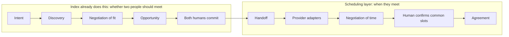
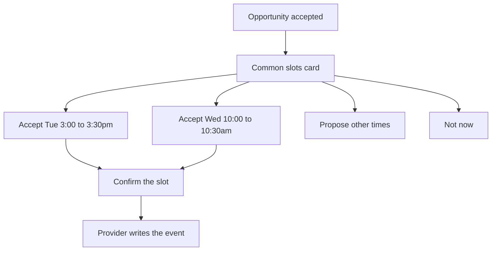

# Privacy-preserving agent-to-agent time negotiation

Seref, team —

On our call on November 11, we got to the last mile the same way a lot of Index matches probably do: the agents did their job, we both wanted to talk, and then someone still sent a Calendly link. You'd even written a prompt about it a few days earlier: people keep sharing Calendly, so what's a great UX in an agentic world? You asked me to put a lightweight proposal together for agent-to-agent time negotiation, in a privacy-preserving way, with a UX that can show common slots and let the humans confirm. This is that proposal.

I'm treating this as a design conversation, not a decision. Where I recommend something, I'll mark it as a recommendation.

Working diagrams for the same material are here, if useful: [FigJam board](https://www.figma.com/board/P1bSbFjfO7b0EYIHfbllO5).

## The problem

Index already does the hard part: intents, discovery, agent-to-agent negotiation of fit, and a double opt-in opportunity. When both humans accept, the protocol's job is done on *whether* these two people should talk. What happens next, today, is logistics in a chat — usually a booking link.

That's a seam, not a failure. The current negotiator is explicit that fit negotiation is not supposed to arrange anything. From `packages/agent/src/negotiate.ts`:

> Nothing is being arranged: scheduling beyond rough availability, locations more precise than a required city or district, prices, addresses and project specifics are for the two of them once they are talking.

The protocol prompt is consistent with that. From `packages/protocol/src/protocol/protocol.prompt.ts`:

> An intent describes a goal, not qualifications, resources, availability, or authority.

So the gap is narrow and well-bounded: after both people have committed to an opportunity, how do we get to an agreed time without Index becoming a calendar company, without dumping calendars into the intent graph, and without forcing everyone onto one booking tool?

## Framing: calendars are products, not primitives

This is easier to talk about in the terms of the [Primitive Map](https://indexnetwork.github.io/primitives/) (source: [indexnetwork/primitives](https://github.com/indexnetwork/primitives), last revised November 13, 2026). The map is clear that calendars, like CRMs and messaging apps, are products shaped by historical software boundaries, not fundamental coordination primitives. There is no "Availability" primitive on the map, and I don't think we should invent one.

What we're actually doing, in the map's own terms:

- An **Opportunity** is already there: matched mutual intents under contextual integrity, with **Consent** when both humans commit.
- Time negotiation is a **Negotiation** that happens *after* that opportunity, under **Appropriateness** (privacy norms for what can be shared).
- It produces a **Decision** (the human confirms a slot), an **Agreement** (the confirmed when), and **Commitments** on each side to show up.
- **Preference** and **Priority** rank windows and constraints (duration, timezone, remote vs in person).
- **Conversation** is the exchange.
- When an agent acts, that's **Delegation** plus **Agent**, on behalf of a verified **Identity**.
- **Workflow** is just the composed sequence, not a new primitive.

Index should remain the intent graph and the opportunity graph. Scheduling is a later Negotiation that leads to an Agreement, not a reason to start storing calendars.

## The key decision: in the existing model, or a separate layer?

This is the architectural question I raised on the call, and I still think it's the one to settle first: does time negotiation live inside Index's existing data model, or in a separate layer that an accepted opportunity hands off to?

The relevant tables today live in `services/api/src/schemas/database.schema.ts`, with conversations in `services/api/src/schemas/conversation.schema.ts`:

- `opportunities` — status: `negotiating`, `pending`, `accepted`, `rejected`, `expired`
- `opportunity_events` — including `opened`, `agreed`, `declined`, `expired`, and `committed` (one commit per human)
- `negotiations` and `negotiation_turns` — bilateral propose / counter / accept / decline, with a text `message`
- `intents`, `agents`, `agent_sessions`
- `conversations` / `messages` once people are connected

There are no calendar or availability tables, which I think is the right call given the comments in `negotiate.ts` and `protocol.prompt.ts`.

### Option A — Extend the existing model

After both humans have committed, add a scheduling phase on the opportunity, or start a second negotiation that reuses `negotiation_turns` (propose / counter / accept / decline) with slot payloads in the turn message. You'd probably add a negotiation kind or phase, structured slot fields, and some pointer to a calendar or provider, all on the same host database.

This reuses the turn log, the hosted negotiator, and the opportunity inbox. The cost is coupling. Calendar-like data would sit next to intents and embeddings in the same Postgres. That pulls Index toward being a calendar company. It's harder to federate — Edge City self-hosting, TEEs, other networks running their own host — without also hosting calendar state. A bilateral fit-negotiation log is an awkward place to grow group scheduling later. Privacy is also harder, because candidate times live in the same store as intent payloads.

### Option B — A separate scheduling layer or protocol

An accepted opportunity hands off to a scheduling session, keyed by opportunity id. Index stays the intent and opportunity graph. The scheduling layer has its own tables or service: the session, slot proposals and responses (or provider-hosted state), and a record of the agreed slot. Provider adapters sit at the edge.

The *pattern* can still be propose / counter / accept / decline. Those turns just don't have to be rows in `negotiation_turns`. Index records the handoff (for example an `opportunity_events` type, or a session pointer) and the confirmed Agreement.

This is looser coupling, a better fit for not becoming a calendar company, and easier to federate: a self-hosted Index can invoke local providers. Privacy is easier if Index never sees raw calendars. Group scheduling can evolve in this layer later without stretching the opportunity model. The cost is a new session and a handoff contract, and the UX has to be designed across Index and providers.

## Three approaches

The in-model vs separate-layer decision is Option A vs Option B. Approach C below is a runtime that should sit on Option B, not a third place to store calendar data.

| | **A. Index-native negotiator, in the existing model** | **B. Separate scheduling layer with provider adapters** | **C. Personal agents negotiate peer-to-peer; Index only relays** |
|---|---|---|---|
| Where state lives | `opportunities`, `negotiations`, `negotiation_turns` | A scheduling session keyed off the accepted opportunity | Agents and providers; Index keeps a session id and the confirmed Agreement |
| Who negotiates times | Index's hosted negotiator | A thin negotiator, or the person's agent, through adapters | The person's agent (Hermes, Grok Bot, Dot, and so on) |
| Calendars | Easy to accidentally pull into Index | Stay with Calendly, Cal.com, Google Calendar, ICS/CalDAV, or a personal agent | Stay with the person and their tools |
| Privacy | Weaker: slots sit next to intent data | Stronger: overlap can be computed at the edge | Strongest, if agents don't dump calendars into Index |
| "Not a calendar company" | Weak fit | Good fit | Best fit |
| People without an agent | Easier: Index can run it | Adapter or authenticated MCP / provider flow | Needs a fallback (that's B's thin negotiator) |
| Federation / self-hosting | Harder; calendar state follows the host | Easier; providers stay local | Easier; Index relays |
| Group scheduling later | Stretches a bilateral turn log | Can grow in this layer | Possible, but only if both sides have capable agents |

### Personal agent vs Index-native negotiator

You asked me, on the call, to put the pros and cons of people's personal agents negotiating versus an Index negotiator negotiating in the proposal, and said you didn't know the answer yet. Here's how I see it.

A personal agent already has context on that person, often already has calendar access, and keeps Index out of the calendar business. The downsides are real: not everyone has Hermes, Grok Bot, or Dot; those agents don't share a runtime; the UX can get inconsistent unless Index still shows the common-slot confirmation; and we still have to notify people.

An Index-native negotiator gives you one inbox, one consistent UX, and a path for people who only use Index. The downside is that Index starts holding availability state, personal agents become second-class, and federation and privacy get harder.

**Recommendation (not a decision):** architect Option B. Prefer Approach C when both people have a personal agent. Use a thin negotiator plus a provider adapter when someone doesn't. Don't put availability windows into `intents`, `negotiations`, or `negotiation_turns`.

## The flow

More precisely:

1. Agents negotiate fit. The opportunity goes pending, then both humans commit, and status becomes `accepted`.
2. Index hands off to a scheduling session for that opportunity.
3. Each side's adapter, or personal agent, produces a small candidate set, or computes overlap privately.
4. Common slots are shown with action buttons.
5. Both humans confirm.
6. The chosen provider writes the event. Index records the Agreement. Both people get notified.

## Privacy

Don't send a full calendar to Index or to the other party. That's Appropriateness.

- **Weaker:** share free/busy for a window. iCalendar and CalDAV already have this — you asked about it on the call. It still leaks busy patterns.
- **Better, and what I'd start with:** each side shares only a small candidate set of slots. Reveal the intersection, not the rest.
- **Stronger, if both runtimes support it:** private set intersection or an equivalent, so only the overlap is learned.
- **Always:** the human confirms common slots before any provider writes an event. That's Consent and Decision.

I would not wait on private set intersection to ship a first version. Candidate sets plus human confirmation get most of the way there without Index ever seeing a full calendar.

## Provider adapter

Conceptual, not built. The scheduling layer talks to providers through a small interface, for example:

- `capabilities`: `candidates`, `freebusy`, and/or `private_overlap`
- `listCandidateSlots({ window, duration, constraints })`
- `proposeSlot` / `respondToSlot`
- `commitSlot` — only after both humans confirm
- `cancelSlot`

Providers I'd want to support first: Google Calendar, Calendly, Cal.com, ICS/CalDAV, and a personal-agent MCP. Other availability tools should fit the same adapter; I don't think Index should pick a winner or ship its own calendar product.

## UX sketch

You asked for action buttons and common-slot confirmation. I'd put a card on the accepted opportunity, in the opportunity inbox you described — opportunity as a kind of file, then scheduling after double opt-in:

**We found times that work for both of you.** No full calendars were shared.

- Accept Tue 3:00–3:30pm PT
- Accept Wed 10:00–10:30am PT
- Propose other times
- Not now

Then a confirm step:

**Book Tuesday 3:00–3:30pm PT with [the other person]?** This will be written to your connected calendar or booking tool. Confirm / Back.

After confirm: Agreement recorded, the chosen provider creates the event, both people are notified.

Which surface ships first — the Index inbox, or the personal agent — is still an open question. I'd keep the confirmation in Index even when agents do the proposing, so the UX stays recognizable.

## Onboarding people who don't have a personal agent

Not everyone is going to have Hermes, Grok Bot, or Index set up as their agent. If we lean only on Approach C, we leave those people behind.

I don't think the answer is an open, unauthenticated MCP that anyone can point ChatGPT or Claude at. The trust problem is obvious: someone else could fill in times on that id.

Better options, in order:

1. A provider booking flow the person already has (Calendly, Cal.com, and so on), through the adapter.
2. A constrained, authenticated MCP, tied to a signed-in Index **Identity**, that ChatGPT or Claude can use on that person's behalf under **Delegation**.
3. The thin Index negotiator as a fallback, still reading only candidate slots from an adapter, not a raw calendar.

I mentioned Instinct on the call as a possible place to put shared compute and negotiation state, because personal agents today aren't in a group chat with each other. I still think that's worth exploring. I don't know whether Instinct should be a base layer or just one runtime, and I wouldn't block the design on it.

## Out of scope

- **Group scheduling.** Useful, and I brought it up, but you were right that it's a more advanced challenge. Option B is meant to leave room for it later. Not in a first version.
- **Index becoming a calendar company.** Index should not provide the calendar, store weekly hours, or replace Calendly, Cal.com, or Google Calendar. Confirmed-slot state on the Index side should stay as small as we can make it: a handoff and an Agreement.

## Open questions from our call

Times are minutes from the start of the November 11 conversation.

1. **UX surface (5:10–7:27).** What's the right agentic UX, and should the common-slot card live in the Index inbox, the personal agent, or both? Sketched above; not settled.
2. **Standards (5:47, 13:08).** Is iCalendar free/busy, or some other availability standard, enough? I treat free/busy as a weaker adapter, not the whole design.
3. **Documentation (6:07–6:21).** Time negotiation isn't documented in the repo yet. This doc is a first pass at that.
4. **Privacy mechanism (6:53, 12:11).** Candidate sets vs private set intersection is still a design choice. I'd start with candidate sets.
5. **Group scheduling (7:30–7:37).** Deferred, as above.
6. **In-model vs separate (8:21–9:48).** The key decision. My recommendation is a separate layer that reuses the turn pattern.
7. **Who negotiates (12:14–12:34).** Personal agents when both have one; thin negotiator plus adapter otherwise.
8. **How much slot state Index keeps (12:14–13:06).** Still open. I'd keep it to the session pointer and the confirmed Agreement.
9. **Onboarding and identity (13:35–14:39).** Authenticated, constrained MCP or a provider flow — not a public id. Details still open.
10. **Instinct (13:35–15:14).** Still open whether it's a base layer or one runtime.
11. **Notifications (15:38–15:47).** Index already notifies by email. The channel after an Agreement is still open.
12. **Trust, spam, and federation (20:32–21:21, 23:26–23:47).** How scheduling inherits the new trust mechanism, and how this works for a self-hosted network (you mentioned Edge City, including possible TEE setups), is still open. Option B is meant to federate more cleanly.
13. **Prior art (7:55–8:12).** You mentioned a Sequoia-backed agentic scheduler as a UX reference and offered to share a link. I didn't catch the name clearly, so I'm not guessing it. I'd like that link if you still have it.

## A short phased plan

1. **Agree on the architecture.** If you're comfortable with Option B, we specify the handoff: accepted opportunity → scheduling session, and what Index stores (session id and confirmed Agreement).
2. **Adapter and privacy.** Write the adapter interface. Ship candidate sets first; keep free/busy as a fallback; leave room for private overlap later.
3. **UX on the accepted opportunity.** Common-slot card, action buttons, confirm step.
4. **Personal-agent path.** When both sides have an agent, let the agents propose and counter; Index still shows the confirmation.
5. **Agentless path.** Authenticated MCP or provider booking flow, plus the thin negotiator fallback.
6. **Later.** Group scheduling, stronger private overlap, and notification channels beyond email.

Happy to iterate on this.

— Genesis
